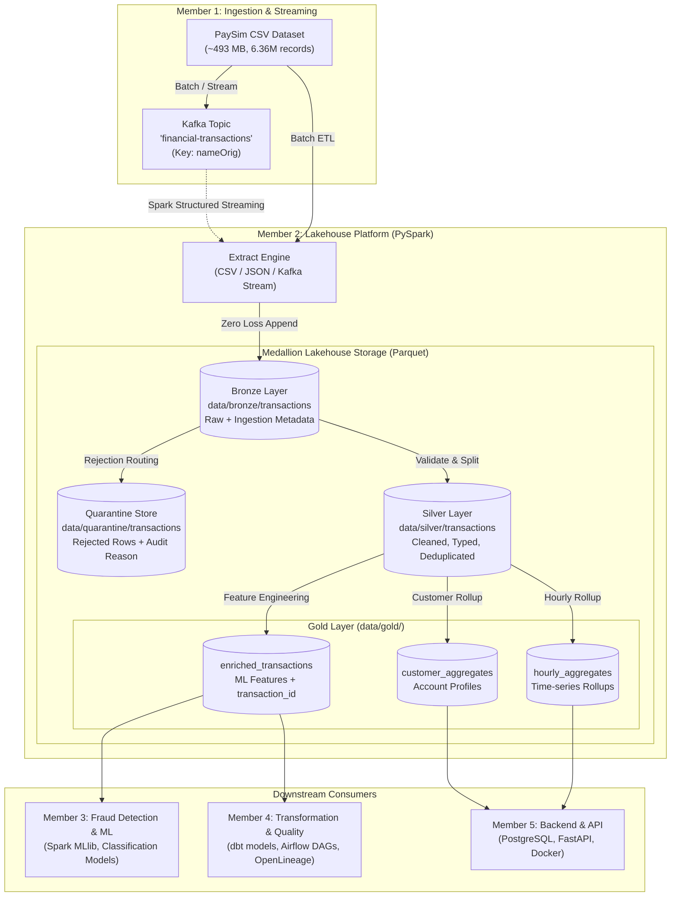

# Member 2: Data Engineering & Lakehouse Architecture
**Real-Time Financial Fraud Detection & Data Engineering Platform**  
**Role:** Member 2 — Data Engineering, Apache Spark & Medallion Lakehouse  
**Technologies:** Apache Spark (PySpark 3.5+ / 4.2+), Apache Parquet, Snappy, Python 3.11, OpenJDK 17  

---

## 1. Executive Summary & Responsibilities

In this 5-member collaborative project, **Member 2** is responsible for the **Data Engineering and Lakehouse** foundation. This component bridges raw streaming/batch ingestion from **Member 1** (Kafka & Python Producer) and prepares robust, high-performance, analytics-ready datasets for **Member 3** (Fraud Detection & Machine Learning using Spark MLlib).

### Primary Responsibilities:
1. **Apache Spark Setup & Optimization**: Reusable, resilient PySpark session configuration with automatic Windows/Linux environment resolution (`JAVA_HOME`, `HADOOP_HOME`, driver binding).
2. **Medallion Lakehouse Architecture**:
   - **Bronze Layer (Raw Archive)**: Ingests raw transactions with zero data loss, appending audit traceability metadata (`ingest_batch_id`, `ingest_timestamp`, `source_system`, `record_hash`).
   - **Silver Layer (Cleaned & Conformed)**: Enforces strict data types, normalizes column aliases (`oldbalanceOrg`/`oldbalanceOrig`), normalizes simulation steps into UTC timestamps, deduplicates records on composite business keys, and isolates rejected records into a dedicated **Quarantine** store.
   - **Gold Layer (Analytics & ML-Ready)**: Engineers high-signal fraud detection features (accounting balance discrepancies, entity flags, velocity indicators) and computes customer-level and time-series aggregations while strictly safeguarding against data leakage.
3. **Modular ETL Pipelines**: Reusable batch and streaming ETL engines (`BatchLakehouseETL`, `StreamingLakehouseETL`) accessible via CLI and programmatic APIs.
4. **Downstream Team Integration**: Formally documented contract, schemas, and PySpark access snippets for Member 3 (ML), Member 4 (dbt & Airflow), and Member 5 (PostgreSQL & FastAPI).
5. **Automated Testing Suite**: Comprehensive unit and integration test suite (16 tests for Member 2 + 23 tests for Member 1 = 39 total passing tests) covering transformations, schema validation, quarantine routing, deduplication, and pipeline idempotency.

---

## 2. Lakehouse Architecture & Data Flow



---

## 3. Detailed Medallion Layer Specifications

### 3.1 Bronze Layer — Raw Data Archive
- **Storage Location**: `data/bronze/transactions/`
- **Format**: Apache Parquet (Snappy compression)
- **Partitioning**: Partitioned by `step` (simulation hour)
- **Design Principle**: Zero data loss. Preserves 100% of the raw string/numeric values exactly as received from Member 1's ingestion pipeline.
- **Audit Metadata Injected**:
  - `ingest_batch_id` (`StringType`): UUID identifying the batch execution run.
  - `ingest_timestamp` (`TimestampType`): UTC timestamp when Spark persisted the record.
  - `source_system` (`StringType`): Input source file path or Kafka topic URI.
  - `record_hash` (`StringType`): SHA-256 hash across all incoming raw columns to ensure cryptographic provenance.

### 3.2 Silver Layer — Cleaned, Validated & Deduplicated
- **Storage Location**: `data/silver/transactions/`
- **Quarantine Location**: `data/quarantine/transactions/`
- **Format**: Apache Parquet (Snappy compression)
- **Transformations Applied**:
  1. **Schema Casting**: Strict typing according to PaySim standard (`step`: int, `type`: string, `amount`: double, balances: double, labels: int).
  2. **Alias Normalization**: Transparently unifies `oldbalanceOrg` and `oldbalanceOrig` aliases.
  3. **Temporal Normalization**: Synthesizes a human-readable UTC `transaction_timestamp` from simulation `step` (`base_date + step * 3600 seconds`).
  4. **Quality Gate & Quarantine Routing**:
     Records are evaluated against strict business rules:
     - `step` must be non-null and $\ge 1$.
     - `type` must be one of: `PAYMENT`, `TRANSFER`, `CASH_OUT`, `DEBIT`, `CASH_IN`.
     - `amount` must be non-null and $\ge 0.0$.
     - `nameOrig` and `nameDest` must be non-null with length $\ge 2$.
     - Account balances must be non-null and $\ge 0.0$.
     - **Rejection Policy**: Records violating any check are **never silently discarded**. They are immediately routed to `data/quarantine/transactions/` enriched with `quarantine_reason` and `quarantined_at`.
  5. **Deduplication**: Deduplicates records using the composite business key `(step, type, amount, nameOrig, nameDest, oldbalanceOrg, newbalanceOrig)`.

### 3.3 Gold Layer — Analytics & ML-Ready
- **Storage Location**: `data/gold/`
- **Tables Produced**:

#### Table 1: `gold/enriched_transactions`
The primary dataset for **Member 3 (ML)**. Contains individual transaction records with synthesized unique IDs, accounting discrepancy features, and behavioral flags.

| Column | Type | Description | Purpose / ML Relevance |
| :--- | :--- | :--- | :--- |
| `transaction_id` | `string` | Deterministic SHA-256 hash of core transaction fields | Unique identifier for transaction tracing |
| `step` | `int` | Simulation hour index ($\ge 1$) | Temporal ordering / time feature |
| `type` | `string` | Transaction type (`TRANSFER`, `CASH_OUT`, etc.) | Categorical feature (One-Hot Encoded) |
| `amount` | `double` | Transaction monetary value | Continuous feature |
| `nameOrig` | `string` | Originating account ID (`C...`) | Account entity reference |
| `oldbalanceOrg` | `double` | Origin balance before transaction | Continuous baseline |
| `newbalanceOrig` | `double` | Origin balance after transaction | Continuous state |
| `nameDest` | `string` | Recipient account ID (`M...` / `C...`) | Destination entity reference |
| `oldbalanceDest`| `double` | Destination balance before transaction | Continuous baseline |
| `newbalanceDest`| `double` | Destination balance after transaction | Continuous state |
| `transaction_timestamp` | `timestamp` | Synthesized UTC timestamp | Time-window feature calculation |
| **`orig_balance_error`** | `double` | `newbalanceOrig + amount - oldbalanceOrg` | **Key fraud feature**: Accounting discrepancy on sender account |
| **`dest_balance_error`** | `double` | `oldbalanceDest + amount - newbalanceDest`| **Key fraud feature**: Accounting discrepancy on recipient account |
| **`is_high_risk_type`** | `int` | `1` if type in (`TRANSFER`, `CASH_OUT`), else `0` | High-risk filter (100% of PaySim fraud is in these 2 types) |
| **`is_merchant_dest`** | `int` | `1` if `nameDest` starts with `'M'`, else `0` | Entity type flag (Merchants cannot be cashed out) |
| **`is_customer_dest`** | `int` | `1` if `nameDest` starts with `'C'`, else `0` | Entity type flag |
| **`orig_zero_balance_flag`** | `int` | `1` if sender balance was 0, else `0` | Anomaly indicator |
| **`dest_zero_balance_flag`** | `int` | `1` if recipient had 0 before and after, else `0`| **Classic PaySim fraud pattern**: Draining to zero-balance accounts |
| **`is_orig_fully_emptied`**| `int` | `1` if account balance went from $>0$ to $0$, else `0` | Account draining pattern indicator |
| **`amount_to_orig_balance_ratio`** | `double` | `amount / (oldbalanceOrg + 1.0)` | Ratio of funds extracted vs available balance |
| **`is_large_transaction`** | `int` | `1` if `amount >= 200,000`, else `0` | Financial regulatory audit threshold |
| **`isFraud`** | `int` | Ground truth label (`1` = Fraud, `0` = Normal) | **SUPERVISED TARGET ONLY** (Do NOT use as input feature) |
| `isFlaggedFraud` | `int` | Business rule flag (`1` = Flagged, `0` = Normal) | Regulatory audit target |

> [!CAUTION]
> **Data Leakage Safeguard**:
> The `isFraud` column is strictly preserved as a **supervised evaluation target** for training and evaluating models. It must never be used in feature engineering pipelines or unsupervised anomaly detection scores.

#### Table 2: `gold/customer_aggregates`
Aggregated profile per originating customer account (`customer_id` / `nameOrig`), providing historical spending context:
- `total_transactions`, `total_amount`, `avg_amount`, `max_amount`, `min_amount`
- Frequency counts: `transfer_count`, `cash_out_count`, `payment_count`, `cash_in_count`, `debit_count`
- Risk indicators: `zero_bal_orig_count`, `avg_orig_balance_error`

#### Table 3: `gold/hourly_aggregates`
Time-series rollups grouped by `step`:
- `hourly_transaction_count`, `hourly_total_amount`, `hourly_avg_amount`, `hourly_max_amount`
- `hourly_transfer_count`, `hourly_cash_out_count`
- Historical metrics: `hourly_fraud_count`, `hourly_fraud_amount`

---

## 4. Consumer Guide for Member 3 (Fraud Detection & ML)

Member 3 can consume the Gold layer directly with PySpark. Below is the recommended integration code:

```python
from pyspark.sql import SparkSession
from pyspark.ml.feature import VectorAssembler, StringIndexer
from pyspark.ml.classification import GBTClassifier
from pyspark.ml.evaluation import BinaryClassificationEvaluator

# 1. Initialize SparkSession
spark = (
    SparkSession.builder.appName("Member3_FraudModelTraining")
    .master("local[*]")
    .getOrCreate()
)

# 2. Load Member 2 Gold Enriched Parquet dataset
gold_path = "data/gold/enriched_transactions"
df = spark.read.parquet(gold_path)

# 3. Separate features from target label (Prevent Data Leakage)
target_col = "isFraud"

feature_cols = [
    "amount",
    "oldbalanceOrg",
    "newbalanceOrig",
    "oldbalanceDest",
    "newbalanceDest",
    "orig_balance_error",
    "dest_balance_error",
    "is_high_risk_type",
    "is_merchant_dest",
    "is_customer_dest",
    "orig_zero_balance_flag",
    "dest_zero_balance_flag",
    "is_orig_fully_emptied",
    "amount_to_orig_balance_ratio",
    "is_large_transaction",
]

# 4. Filter to high-risk types where fraud occurs (TRANSFER & CASH_OUT)
training_df = df.filter("type IN ('TRANSFER', 'CASH_OUT')")

# 5. Assemble feature vector
assembler = VectorAssembler(inputCols=feature_cols, outputCol="features")
model_data = assembler.transform(training_df).select("transaction_id", "features", target_col)

# 6. Train-test split
train_data, test_data = model_data.randomSplit([0.8, 0.2], seed=42)

# 7. Train Spark MLlib Classifier (e.g., Gradient-Boosted Trees or Random Forest)
gbt = GBTClassifier(featuresCol="features", labelCol=target_col, maxIter=20)
model = gbt.fit(train_data)

# 8. Evaluate predictions
predictions = model.transform(test_data)
evaluator = BinaryClassificationEvaluator(labelCol=target_col, metricName="areaUnderPR")
pr_auc = evaluator.evaluate(predictions)
print(f"Member 3 Model PR-AUC: {pr_auc:.4f}")
```

---

## 5. Directory Structure

```text
financial-fraud-platform/
├── dataset/
│   ├── paysim.csv                       # Full PaySim dataset (493 MB)
│   └── sample_paysim.csv                # Synthetic sample for quick testing
├── hadoop/                              # Windows Hadoop binaries
│   └── bin/
│       ├── winutils.exe
│       └── hadoop.dll
├── data/                                # Medallion Lakehouse Parquet Storage
│   ├── bronze/transactions/             # Raw Parquet archive + metadata
│   ├── silver/transactions/             # Cleaned, typed, deduplicated Parquet
│   ├── quarantine/transactions/         # Rejected records + quarantine reasons
│   └── gold/
│       ├── enriched_transactions/       # ML features + transaction_id (For Member 3)
│       ├── customer_aggregates/         # Customer profile aggregates
│       └── hourly_aggregates/           # Hourly temporal metrics
├── src/
│   ├── lakehouse/                       # Lakehouse core management
│   │   ├── __init__.py
│   │   ├── config.py                    # Centralized paths and Spark settings
│   │   ├── spark_session.py             # Resilient PySpark session factory
│   │   ├── bronze.py                    # Bronze layer manager
│   │   ├── silver.py                    # Silver layer manager (cleaning & quarantine)
│   │   └── gold.py                      # Gold layer manager (features & aggregations)
│   ├── transformations/                 # Pure PySpark DataFrame logic
│   │   ├── __init__.py
│   │   ├── cleaning.py                  # Schema casting, alias fix, quality checks
│   │   ├── features.py                  # Balance errors, entity flags, transaction_id
│   │   └── aggregations.py              # Customer & time summary rollups
│   ├── etl/                             # ETL pipeline orchestrators
│   │   ├── __init__.py
│   │   ├── batch_etl.py                 # Batch pipeline: Bronze -> Silver -> Gold
│   │   └── streaming_etl.py             # Spark Structured Streaming from Kafka
│   └── utils/
│       ├── __init__.py
│       └── lakehouse_telemetry.py       # Metrics collector & CLI reporting
├── scripts/
│   ├── run_lakehouse_etl.py             # CLI entrypoint for Lakehouse ETL (Member 2)
│   ├── run_ingestion.py                 # CLI entrypoint for Kafka Ingestion (Member 1)
│   └── verify_consumer.py               # Kafka consumer verification (Member 1)
├── tests/
│   ├── conftest.py                      # Shared fixtures (PySpark session, synthetic CSVs)
│   ├── test_lakehouse.py                # 10 unit tests for Lakehouse layers & transforms
│   ├── test_etl.py                      # 6 E2E integration tests for BatchLakehouseETL
│   ├── test_models.py                   # Member 1 model tests (10 tests)
│   ├── test_pipeline.py                 # Member 1 pipeline tests (3 tests)
│   ├── test_producer.py                 # Member 1 producer tests (4 tests)
│   └── test_reader.py                   # Member 1 reader tests (6 tests)
├── docs/
│   └── MEMBER2_DATA_ENGINEERING.md      # This document
├── pytest.ini                           # Pytest configuration
├── requirements.txt                     # Unified project dependencies
└── docker-compose.yml                   # Apache Kafka (KRaft mode) & Kafka UI
```

---

## 6. Installation & Execution Guide

### 6.1 Prerequisites
- **Python**: 3.10+ (Python 3.11 recommended for PySpark 3.5+)
- **Java**: OpenJDK 17 (`Eclipse Adoptium Temurin 17` installed)
- **Hadoop Binaries (Windows only)**: `winutils.exe` and `hadoop.dll` located in `hadoop/bin/` (auto-configured by `spark_session.py`).

### 6.2 Environment Setup
```bash
# 1. Create and activate virtual environment
py -3.11 -m venv .venv
.venv\Scripts\activate   # Windows PowerShell: .venv\Scripts\Activate.ps1

# 2. Install dependencies
pip install -r requirements.txt
```

### 6.3 Running Automated Tests
The test suite validates both Member 1's ingestion code and Member 2's lakehouse pipeline on synthetic datasets:
```bash
pytest -v
```
**Test Results**: **39 passed** in ~1.5 minutes.

### 6.4 Running the Batch Lakehouse ETL Pipeline
Process any CSV, JSON, or Parquet dataset through Bronze $\to$ Silver $\to$ Gold:

```bash
# Run on sample dataset (12 records):
python scripts/run_lakehouse_etl.py --mode batch --input-path dataset/sample_paysim.csv

# Run on the full PaySim dataset with a limit of 50,000 records:
python scripts/run_lakehouse_etl.py --mode batch --input-path dataset/paysim.csv --max-records 50000

# Run on custom storage paths:
python scripts/run_lakehouse_etl.py --mode batch --input-path dataset/sample_paysim.csv --data-dir my_lakehouse
```

**Console Output Example**:
```text
======================================================================
LAKEHOUSE ETL PIPELINE RUN SUMMARY (BatchLakehouseETL)
======================================================================
  Total Duration: 29.44s

[EXTRACT]
  Input Source:     dataset/sample_paysim.csv
  Extracted Rows:   12

[BRONZE LAYER]
  Destination:      data/bronze/transactions
  Written Records:  12
  Write Mode:       overwrite

[SILVER LAYER]
  Valid Records:    10
  Quarantined:      2
  Duplicates Dropped:0
  Silver Storage:   data/silver/transactions
  Quarantine Storage:data/quarantine/transactions

[GOLD LAYER - DOWNSTREAM ANALYTICS & ML]
  Enriched Features: 10 rows
  Customer Profiles: 10 accounts
  Hourly Rollups:    1 hours
  Enriched Path:     data/gold/enriched_transactions
======================================================================
```

### 6.5 Running Streaming ETL (Kafka $\to$ Lakehouse)
When Docker / Apache Kafka is running:
```bash
# 1. Start Kafka via Docker Compose
docker compose up -d

# 2. Start Member 1 Ingestion Producer in another terminal
python scripts/run_ingestion.py --eps 100

# 3. Start Member 2 Streaming Lakehouse Consumer
python scripts/run_lakehouse_etl.py --mode streaming
```
Micro-batches are triggered every 5 seconds, writing continuous transactions directly into Bronze and Silver Parquet stores.

---

## 7. Assumptions & Known Limitations
1. **Local Mode Execution**: Configured with `master("local[*]")` and `shuffle.partitions=4` for single-node development and testing. In a production cluster (e.g., Dataproc / AWS EMR), update `SPARK_MASTER` in `.env`.
2. **Ground Truth Labels in Production**: In an actual live banking environment, `isFraud` is not known at the moment of payment. Features in the Gold layer rely strictly on pre-transaction data, amounts, and mathematical balance formulas to guarantee zero leakage.
3. **Kafka Availability**: In offline development without Docker/Kafka, the full Lakehouse pipeline can be thoroughly executed and tested using the batch entry point or `--dry-run` modes.
